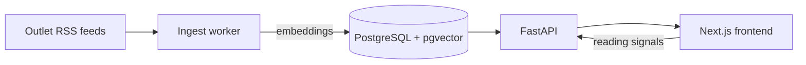

# CHORUS

**A tech-news reader that groups the same story from many outlets into one card, and learns what you like to read.**

**Live:** https://chorus.anastasiia.dev

When a big story breaks, many sites publish their own version of it. CHORUS pulls those articles in, works out which ones are about the same event, and shows them as one story. The feed is ranked by your reading habits, and each card explains why it was picked for you.

## Tech stack

- **Backend:** Python, FastAPI, SQLAlchemy (async), PostgreSQL + pgvector, Alembic
- **ML:** sentence-transformers, scikit-learn, NumPy
- **Frontend:** Next.js, React, TypeScript, Tailwind CSS
- **Quality:** pytest, Playwright, Ruff, ESLint, GitHub Actions CI, Docker Compose

## Features

- Groups articles by meaning, not by matching keywords
- Shows how each outlet covered the same story, side by side
- Personal ranking that learns from reading, saving and skipping
- Explains each recommendation in a short line
- Live updates: refreshes only when new articles arrive
- Topic filters, search, sorting and muting outlets
- The frontend runs on its own with sample data

## How it works



1. **Ingest:** a scheduled worker fetches outlet RSS feeds and stores new articles.
2. **Embed:** each article becomes a vector, using a model that runs locally.
3. **Group:** vector search finds the closest recent story. The article joins it if close enough, or starts a new one.
4. **Rank:** stories are scored by how well they match your interests, how many outlets cover them, and how fresh they are.
5. **Learn:** each interaction moves your taste profile toward or away from a story.

## Quick start

Requires Docker and Node.js.

```bash
# Backend: database, API and news worker
cd backend
docker compose up -d

# Frontend
cd frontend
cp .env.example .env.local
npm install
npm run dev
```

Open http://localhost:3000. API docs are at http://localhost:8000/docs.

## Deployment

Runs for free on Cloudflare Workers (frontend), Render (API), Neon (database) and a scheduled GitHub Actions job (news worker).

## Tests

```bash
cd backend  && uv run pytest
cd frontend && npm run lint && npm run typecheck && npm run test:e2e
```

CI runs all checks on every push and pull request.

## Engineering decisions

- **Local embeddings:** no per-article cost, no API keys, repeatable results.
- **Grouping as articles arrive**, plus a command that rebuilds every story after tuning.
- **Cheap live updates:** the page polls a tiny version endpoint and reloads only when it changes.
- **Safe background jobs:** a database lock stops ingests from overlapping.
